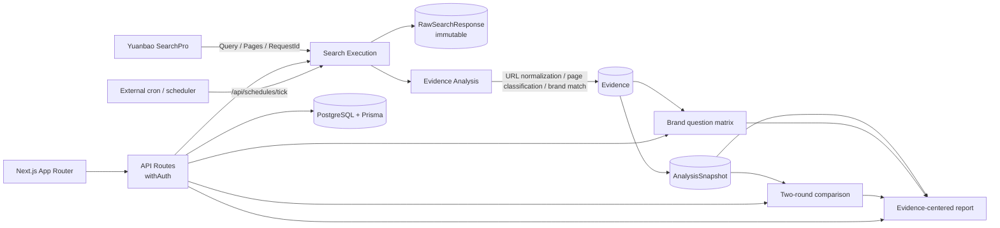

<div align="center">


# GEO Radar

**Evidence-first GEO platform for AI search visibility.**

Turn real AI-search web results into traceable, recomputable and reviewable brand evidence.

[](https://nextjs.org/)
[](https://www.typescriptlang.org/)
[](https://www.prisma.io/)
[](https://www.postgresql.org/)
[](https://github.com/Leterhong/GEO-Radar/actions/workflows/ci.yml)
[](https://leterhong.github.io/GEO-Radar/)
[](LICENSE)

[Live Site](https://leterhong.github.io/GEO-Radar/) · [Deployment](docs/deployment.md) · [Agent integration](#agent-integration-skill--mcp--dsh-plugin) · [Docs](#documentation)

[简体中文](README.md) · [English](README.en.md)

</div>

---

> **In one sentence**: no opaque “AI visibility score”. Store every real search result, turn pages into evidence, then compute metrics, matrices, comparisons and reports.

---

## Quick links

| Resource | URL |
| --- | --- |
| GitHub repository | https://github.com/Leterhong/GEO-Radar |
| Live demo | https://leterhong.github.io/GEO-Radar/ |
| **Agent Skill** | https://github.com/Leterhong/GEO-Radar/tree/main/skills/geo-radar |
| **MCP Server** | https://github.com/Leterhong/GEO-Radar/tree/main/packages/geo-radar-mcp |
| **DSH plugin** | https://github.com/Leterhong/GEO-Radar/tree/main/packages/dsh-geo-radar |
| Quick start / deployment | [docs/deployment.md](docs/deployment.md) · [.env.example](.env.example) |
| Agent integration docs | https://github.com/Leterhong/GEO-Radar/blob/main/docs/agent-integration.md |

---

## Features

- **Yuanbao SearchPro**: real web results + `RequestId`; API Key encrypted with AES-256-GCM.
- **Page-level evidence**: URL normalization, explainable page classification, brand match basis, human review.
- **Brand question matrix**: question × brand/competitor; found / not found / failed / empty / needs review.
- **Immutable snapshots**: `COLLECTION` + `RECOMPUTE`; rule changes never rewrite history.
- **Two-round comparison**: common questions, metric movement, page diff, data quality.
- **Evidence-centered report**: 14 sections; HTML / Markdown / metrics CSV / questions CSV / evidence CSV.
- **Scheduled collection**: external cron/scheduler, cost confirmation, concurrency and idempotency.
- **Workspace isolation**: every API uses `withAuth`; Mock never enters real metrics by default.

Two principles:

| Principle | Implementation |
| --- | --- |
| Failure ≠ not found | failed / empty / not found / needs review are distinct |
| Insufficient sample ≠ 0% | zero denominator or unconfigured official domain → “not computable” |

---

## Agent integration: Skill / MCP / DSH plugin

| Form | Purpose |
| --- | --- |
| [Agent Skill](https://github.com/Leterhong/GEO-Radar/tree/main/skills/geo-radar) | workflow, evidence citation and cost/safety rules |
| [MCP Server](https://github.com/Leterhong/GEO-Radar/tree/main/packages/geo-radar-mcp) | 12 `geo_*` tools for Claude Code / Cursor / DSH |
| [DSH Plugin](https://github.com/Leterhong/GEO-Radar/tree/main/packages/dsh-geo-radar) | pure declaration plugin exposing `mcp__geo-radar__*` |

### 1. Create a token

```bash
npm run token:create -- you@example.com "MCP token"
# printed once: gr_...
```

Or use **Settings → API Token / MCP**. Tokens are workspace-scoped; only a SHA-256 hash is stored.

### 2. MCP configuration

```json
{
  "mcpServers": {
    "geo-radar": {
      "command": "node",
      "args": ["/absolute/path/to/GEO-Radar/packages/geo-radar-mcp/index.mjs"],
      "env": {
        "GEO_RADAR_URL": "http://127.0.0.1:3000",
        "GEO_RADAR_TOKEN": "gr_..."
      }
    }
  }
}
```

```bash
GEO_RADAR_URL=http://127.0.0.1:3000 \
GEO_RADAR_TOKEN=gr_... \
npm run smoke:mcp
```

### 3. DSH plugin

```bash
export GEO_RADAR_URL=http://127.0.0.1:3000
export GEO_RADAR_TOKEN=gr_...
node scripts/install-dsh-plugin.mjs
dsh plugin --profile web add "$PWD/packages/dsh-geo-radar"
# restart DSH; tools appear as mcp__geo-radar__geo_*
```

### 4. Safety

- `geo_create_task` only creates a QUEUED task; it does not search.
- `geo_start_task` refuses REAL tasks unless `confirmReal=true`.
- Prefer MOCK for workflow tests; MCP never invents metrics or results.

---

## Architecture



```text
Yuanbao SearchPro
  └─ RawSearchResponse      full JSON / RequestId (immutable)
       └─ SearchResult      title / URL / domain / snippet / position
            └─ Evidence     page type / source role / match basis / human review
                 └─ AnalysisSnapshot
                      COLLECTION / RECOMPUTE
                      └─ Matrix / Comparison / Report
```

Rule versions: `url-norm-v1`, `page-classify-v1`, `evidence-v2`, `geo-metrics-v2`, `snapshot-v1`, `comparison-v1`, `search-report-v1`.

---

## Documentation

| Document | Content |
| --- | --- |
| [docs/evidence-chain.md](docs/evidence-chain.md) | evidence chain, matrix, snapshots, comparison, report |
| [docs/architecture.md](docs/architecture.md) | system architecture |
| [docs/data-dictionary.md](docs/data-dictionary.md) | data model |
| [docs/agent-integration.md](docs/agent-integration.md) | Skill / MCP / DSH |
| [docs/yuanbao-integration.md](docs/yuanbao-integration.md) | SearchPro integration |
| [docs/deployment.md](docs/deployment.md) | deployment, auth cookies, scheduling |
| [docs/testing.md](docs/testing.md) | testing |
| [docs/article-geo-radar.md](docs/article-geo-radar.md) | case study |

---

## Contributing

Issues and PRs are welcome. Read [CONTRIBUTING.md](CONTRIBUTING.md); report security issues via [SECURITY.md](SECURITY.md), not a public issue.

---

## Yuanbao Search

GEO Radar has one external search source: **Tencent Cloud Yuanbao SearchPro**.

```text
POST https://api.wsa.cloud.tencent.com/SearchPro
Authorization: Bearer <Service API Key>
Body: { Query, ... }
Response: Pages[] + RequestId + Version + Msg
```

More: [docs/yuanbao-integration.md](docs/yuanbao-integration.md) · [docs/geo-analysis.md](docs/geo-analysis.md)

---

## License

[MIT](LICENSE) © 2026 Leterhong

---

## Acknowledgements

- [Tencent Cloud Yuanbao Search](https://cloud.tencent.com/product/wsa) — real web retrieval
- [Next.js](https://nextjs.org/), [React](https://react.dev/), [TypeScript](https://www.typescriptlang.org/)
- [Prisma](https://www.prisma.io/), [PostgreSQL](https://www.postgresql.org/)
- [Radix UI](https://www.radix-ui.com/), [Tailwind CSS](https://tailwindcss.com/), [Recharts](https://recharts.org/)
- [Vitest](https://vitest.dev/), [Playwright](https://playwright.dev/)

<div align="center">

**If this project helps you, please Star ⭐**

</div>
