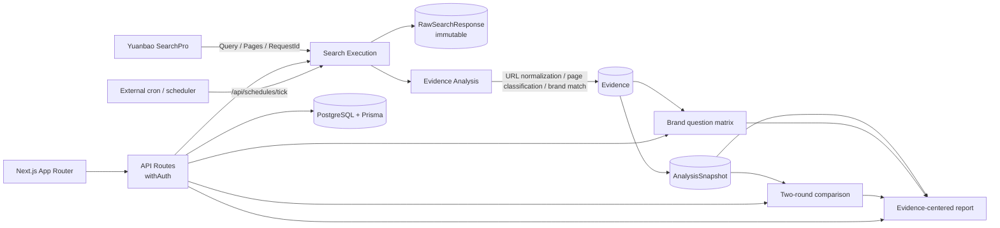

<div align="center">


# GEO Radar

**Evidence-first GEO platform for AI search visibility.**

Turn real AI-search web results into traceable, recomputable and reviewable brand evidence.

[](https://nextjs.org/)
[](https://www.typescriptlang.org/)
[](https://www.prisma.io/)
[](https://www.postgresql.org/)
[](#testing)
[](https://github.com/Leterhong/GEO-Radar/actions/workflows/ci.yml)
[](https://leterhong.github.io/GEO-Radar/)
[](LICENSE)

[Live Site](https://leterhong.github.io/GEO-Radar/) · [Quick start](#quick-start) · [Agent integration](#agent-integration-skill--mcp--dsh-plugin) · [Demo](#demo) · [Docs](#documentation)

[简体中文](README.md) · [English](README.en.md)


<sub>Raw results are immutable; page analysis, brand matching and human review live in a separate layer.</sub>

</div>

---

> **In one sentence**: no opaque “AI visibility score”. Store every real search result, turn pages into evidence, then compute metrics, matrices, comparisons and reports.

> **Status**: prototype. Real calls to Tencent Cloud Yuanbao SearchPro have been made; APIs and definitions are still evolving.

## Quick links

| Resource | URL |
| --- | --- |
| GitHub repository | https://github.com/Leterhong/GEO-Radar |
| Live demo | https://leterhong.github.io/GEO-Radar/ |
| Demo video (8 min) | https://github.com/Leterhong/GEO-Radar/releases/tag/v0.1.0 |
| **Agent Skill** | https://github.com/Leterhong/GEO-Radar/tree/main/skills/geo-radar |
| **MCP Server** | https://github.com/Leterhong/GEO-Radar/tree/main/packages/geo-radar-mcp |
| **DSH plugin** | https://github.com/Leterhong/GEO-Radar/tree/main/packages/dsh-geo-radar |
| Agent integration docs | https://github.com/Leterhong/GEO-Radar/blob/main/docs/agent-integration.md |

---

## Features

- **Yuanbao SearchPro**: real web results + `RequestId`; API Key encrypted with AES-256-GCM.
- **Page-level evidence**: URL normalization, explainable page classification, brand match basis, human review.
- **Brand question matrix**: question × brand/competitor; found / not found / failed / empty / needs review.
- **Immutable snapshots**: `COLLECTION` + `RECOMPUTE`; rule changes never rewrite history.
- **Two-round comparison**: common questions, metric movement, page diff, data quality.
- **Evidence-centered report**: 14 sections; HTML / Markdown / metrics CSV / questions CSV / evidence CSV.
- **Scheduled collection**: external cron/scheduler, cost confirmation, concurrency and idempotency.
- **Workspace isolation**: every API uses `withAuth`; Mock never enters real metrics by default.

Two principles:

| Principle | Implementation |
| --- | --- |
| Failure ≠ not found | failed / empty / not found / needs review are distinct |
| Insufficient sample ≠ 0% | zero denominator or unconfigured official domain → “not computable” |

---

## Agent integration: Skill / MCP / DSH plugin

| Form | Purpose |
| --- | --- |
| [Agent Skill](https://github.com/Leterhong/GEO-Radar/tree/main/skills/geo-radar) | workflow, evidence citation and cost/safety rules |
| [MCP Server](https://github.com/Leterhong/GEO-Radar/tree/main/packages/geo-radar-mcp) | 12 `geo_*` tools for Claude Code / Cursor / DSH |
| [DSH Plugin](https://github.com/Leterhong/GEO-Radar/tree/main/packages/dsh-geo-radar) | pure declaration plugin exposing `mcp__geo-radar__*` |

### 1. Create a token

```bash
npm run token:create -- you@example.com "MCP token"
# printed once: gr_...
```

Or use **Settings → API Token / MCP**. Tokens are workspace-scoped; only a SHA-256 hash is stored.

### 2. MCP configuration

```json
{
  "mcpServers": {
    "geo-radar": {
      "command": "node",
      "args": ["/absolute/path/to/GEO-Radar/packages/geo-radar-mcp/index.mjs"],
      "env": {
        "GEO_RADAR_URL": "http://127.0.0.1:3000",
        "GEO_RADAR_TOKEN": "gr_..."
      }
    }
  }
}
```

```bash
GEO_RADAR_URL=http://127.0.0.1:3000 \
GEO_RADAR_TOKEN=gr_... \
npm run smoke:mcp
```

### 3. DSH plugin

```bash
export GEO_RADAR_URL=http://127.0.0.1:3000
export GEO_RADAR_TOKEN=gr_...
node scripts/install-dsh-plugin.mjs
dsh plugin --profile web add "$PWD/packages/dsh-geo-radar"
# restart DSH; tools appear as mcp__geo-radar__geo_*
```

### 4. Safety

- `geo_create_task` only creates a QUEUED task; it does not search.
- `geo_start_task` refuses REAL tasks unless `confirmReal=true`.
- Prefer MOCK for workflow tests; MCP never invents metrics or results.

> MCP runs locally over stdio; no hosted server is required. Remote HTTP MCP needs separate deployment.

---

## Architecture



```text
Yuanbao SearchPro
  └─ RawSearchResponse      full JSON / RequestId (immutable)
       └─ SearchResult      title / URL / domain / snippet / position
            └─ Evidence     page type / source role / match basis / human review
                 └─ AnalysisSnapshot
                      COLLECTION / RECOMPUTE
                      └─ Matrix / Comparison / Report
```

Rule versions: `url-norm-v1`, `page-classify-v1`, `evidence-v2`, `geo-metrics-v2`, `snapshot-v1`, `comparison-v1`, `search-report-v1`.

---

## Yuanbao Search

GEO Radar has one external search source: **Tencent Cloud Yuanbao SearchPro**.

```text
POST https://api.wsa.cloud.tencent.com/SearchPro
Authorization: Bearer <Service API Key>
Body: { Query, ... }
Response: Pages[] + RequestId + Version + Msg
```

- API Key accepted server-side only and encrypted; never returned in full
- Request layer handles timeout, retry, cancel and HTTP/business errors
- Every result keeps `RequestId`; evidence and reports point back to the request
- Real tasks require `YUANBAO_SEARCH_ENABLED=true` and a passed connection test
- Mock is explicitly isolated from real metrics and formal reports

Real sample (10 questions, second retest):

| Metric | Result |
| --- | --- |
| Successful questions / results | 10 / 10, 98 |
| Per-request duration | 81–385ms (this sample) |
| Brand mention question rate | 6 / 10 = 60% |
| Official site coverage | 0 / 10 = 0% |
| Third-party page coverage | 6 / 10 = 60% |
| Competitor mention | Doubao 70% / Kimi 70% |

> Official 0% means “official domain configured, but none of the 98 results came from it” — not the placeholder for an unconfigured domain.

More: [docs/yuanbao-integration.md](docs/yuanbao-integration.md) · [docs/geo-analysis.md](docs/geo-analysis.md)

---

## Quick start

### Docker (recommended)

```bash
git clone https://github.com/Leterhong/GEO-Radar.git
cd GEO-Radar
npm run docker:up
# http://localhost:3000
```

The first run generates `.env.docker` with random secrets (never committed), builds and waits for health.

```bash
npm run docker:down
npm run docker:logs
```

> Docker Desktop / Docker Engine + Compose v2 required. Port conflict: `APP_PORT=3300 POSTGRES_PORT=15433 npm run docker:up`.

### Local development

```bash
npm ci
cp .env.example .env.local
npm run dev:db      # embedded PostgreSQL, primarily Windows
npm run db:migrate
npm run dev
```

Required env:

| Variable | Description |
| --- | --- |
| `DATABASE_URL` | PostgreSQL connection string |
| `AUTH_SECRET` | session signing secret, 32 random bytes |
| `CREDENTIAL_ENCRYPTION_KEY` | 32-byte hex AES-256-GCM key |
| `YUANBAO_SEARCH_ENABLED` | `true` enables real Yuanbao calls |

See [.env.example](.env.example) and [docs/deployment.md](docs/deployment.md).

---

## Commands

```bash
npm run dev                 # dev server
npm run build               # production build
npm test                    # 122 tests
npm run docker:up           # one-command Docker demo
npm run token:create -- <email> "<name>"  # create MCP token
npm run smoke:mcp           # verify MCP
npm run dsh:install         # generate DSH plugin patch
npm run scheduler           # standalone scheduler
```

More: [docs/testing.md](docs/testing.md) · [docs/deployment.md](docs/deployment.md)

---

## Testing

- **122 Vitest tests** (7 files): evidence chain, matrix, snapshots, comparison, reports, scheduling, Yuanbao provider, permissions, tokens, integration
- **58 end-to-end smoke checks**
- **42 evidence-chain smoke checks**
- **Playwright UI checks** + browser console errors
- GitHub Actions: typecheck / lint / test / build + **Docker Compose one-click**

```bash
npm run typecheck && npm run lint && npm test && npm run build
```

---

## Screenshots

| Brand question matrix | Evidence-centered report |
| --- | --- |
| [](https://cdn.jsdelivr.net/gh/Leterhong/GEO-Radar@main/docs/assets/readme/matrix.jpg) | [](https://cdn.jsdelivr.net/gh/Leterhong/GEO-Radar@main/docs/assets/readme/report.jpg) |

---

## Demo

[](https://github.com/Leterhong/GEO-Radar/releases/download/v0.1.0/GEO-Radar-yuanbao-demo-1440p.mp4)

**7 min 57 s · 1440p · real Yuanbao calls + full flow**

[▶ Watch](https://github.com/Leterhong/GEO-Radar/releases/download/v0.1.0/GEO-Radar-yuanbao-demo-1440p.mp4) · [Subtitles](docs/assets/video/georadar-yuanbao-tour.srt)

---

## Project structure

```text
src/app/              Next.js pages + API routes
src/server/           search, evidence, matrix, snapshot, comparison, report, schedule
src/lib/providers/    Yuanbao SearchPro / Mock provider
prisma/               schema + migrations
packages/geo-radar-mcp/   MCP server (12 tools)
packages/dsh-geo-radar/   DSH plugin
skills/geo-radar/         Agent Skill
scripts/              smoke, token, Docker, video tools
tests/                unit / integration / Playwright
docs/                 architecture, data dictionary, API, deployment, agent integration
```

---

## Documentation

| Document | Content |
| --- | --- |
| [docs/evidence-chain.md](docs/evidence-chain.md) | evidence chain, matrix, snapshots, comparison, report |
| [docs/architecture.md](docs/architecture.md) | system architecture |
| [docs/data-dictionary.md](docs/data-dictionary.md) | data model |
| [docs/agent-integration.md](docs/agent-integration.md) | Skill / MCP / DSH |
| [docs/yuanbao-integration.md](docs/yuanbao-integration.md) | SearchPro integration |
| [docs/deployment.md](docs/deployment.md) | deployment, auth cookies, scheduling |
| [docs/testing.md](docs/testing.md) | testing |
| [docs/article-geo-radar.md](docs/article-geo-radar.md) | case study |

---

## Known limitations

- PDF export not implemented (HTML can be printed to PDF).
- Task execution runs in the web process; a restart interrupts running tasks.
- Scheduling requires external cron / `npm run scheduler`.
- Page classification is heuristic; long-tail sites may be OTHER/UNKNOWN.
- Volatility is an observed range, not a confidence interval.
- Real API stress testing, Redis rate limiting and a separate worker are still roadmap.
- Legacy tasks may lack COLLECTION snapshots; comparison labels the live fallback.

## Roadmap

- [ ] PDF report export
- [ ] Separate task worker
- [ ] Redis rate limiting and queue
- [ ] More search providers
- [ ] Page-classification rule packs
- [ ] Remote HTTP MCP

---

## Contributing

Issues and PRs are welcome. Read [CONTRIBUTING.md](CONTRIBUTING.md); report security issues via [SECURITY.md](SECURITY.md), not a public issue.

## License

[MIT](LICENSE) © 2026 Leterhong

> GEO Radar is an independent open-source project, not affiliated with Tencent Cloud/Yuanbao Search; Yuanbao Search is an external data source.
