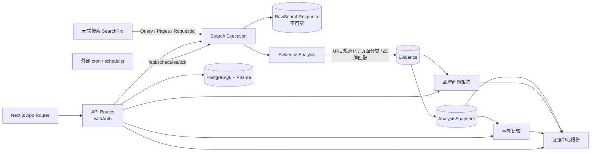

<div align="center">


# GEO Radar

**Evidence-first GEO platform for AI search visibility.**

把 AI 搜索的网页结果，变成可追溯、可复算、可复盘的品牌证据。

[](https://nextjs.org/)
[](https://www.typescriptlang.org/)
[](https://www.prisma.io/)
[](https://www.postgresql.org/)
[](https://github.com/Leterhong/GEO-Radar/actions/workflows/ci.yml)
[](https://leterhong.github.io/GEO-Radar/)
[](LICENSE)

[Live Site](https://leterhong.github.io/GEO-Radar/) · [部署文档](docs/deployment.md) · [Agent 集成](#agent-集成skill--mcp--dsh-插件) · [文档](#文档)

[简体中文](README.md) · [English](README.en.md)

</div>

---

> **一句话**：不生产“AI 可见度分数”，而是保存每一次真实搜索的原始结果，把页面变成证据，再计算指标、做矩阵、复测和报告。

---

## 快速入口

| 入口 | 地址 |
| --- | --- |
| GitHub 仓库 | https://github.com/Leterhong/GEO-Radar |
| Live Demo | https://leterhong.github.io/GEO-Radar/ |
| **Agent Skill** | https://github.com/Leterhong/GEO-Radar/tree/main/skills/geo-radar |
| **MCP Server** | https://github.com/Leterhong/GEO-Radar/tree/main/packages/geo-radar-mcp |
| **DSH 插件** | https://github.com/Leterhong/GEO-Radar/tree/main/packages/dsh-geo-radar |
| 快速开始 / 部署 | [docs/deployment.md](docs/deployment.md) · [.env.example](.env.example) |
| Agent 接入文档 | https://github.com/Leterhong/GEO-Radar/blob/main/docs/agent-integration.md |

---

## 核心能力

- **元宝 SearchPro 接入**：真实网页结果 + `RequestId`，API Key 服务端 AES-256-GCM 加密。
- **页面级证据链**：URL 规范化、可解释页面分类、品牌匹配依据、人工复核历史；原始层不覆盖。
- **品牌问题矩阵**：问题 × 品牌/竞品；已发现 / 未发现 / 失败 / 空结果 / 待复核分开。
- **不可变快照**：`COLLECTION` + `RECOMPUTE`；历史不被规则更新改写。
- **两轮复测与比较**：共同问题子集、指标变化、页面增减、数据质量。
- **证据中心报告**：14 节报告，HTML / Markdown / 指标 CSV / 问题 CSV / 证据 CSV。
- **定时采集**：外部 cron / scheduler，成本确认、并发上限、幂等执行。
- **Workspace 隔离**：所有 API 经过 `withAuth`，Mock 默认不进入真实指标。

### 两个原则

| 原则 | 做法 |
| --- | --- |
| 失败 ≠ 未发现 | 失败、空结果、未发现、待复核是不同状态 |
| 样本不足 ≠ 0% | 分母为 0 或未配置官网时显示「不可计算」，不显示 0% |

---

## Agent 集成：Skill / MCP / DSH 插件

GEO Radar 也可以被 Agent 直接调用。

| 形态 | 作用 |
| --- | --- |
| [Agent Skill](https://github.com/Leterhong/GEO-Radar/tree/main/skills/geo-radar) | 工作流、证据引用、成本与安全规则；含 references/examples |
| [MCP Server](https://github.com/Leterhong/GEO-Radar/tree/main/packages/geo-radar-mcp) | 21 个 `geo_*` 工具：搜索、证据、分析、报告 |
| [DSH Plugin](https://github.com/Leterhong/GEO-Radar/tree/main/packages/dsh-geo-radar) | 通过官方 `dsh-mcp-client` 挂载为 `mcp__geo-radar__*` |

MCP 工具覆盖：

```text
geo_search_web / geo_batch_search
geo_list_evidence / geo_search_evidence / geo_get_evidence
geo_analyze_brand / geo_analyze_domain
geo_compare_competitors / geo_analyze_citations
geo_generate_report / geo_get_report
```

### 1. 创建 Token

```bash
npm run token:create -- you@example.com "MCP token"
# 只显示一次：gr_...
```

也可以在 **设置 → API Token / MCP** 创建/撤销。Token 只存 SHA-256 哈希；可选择只读或读写。

### 2. MCP 配置

```json
{
  "mcpServers": {
    "geo-radar": {
      "command": "node",
      "args": ["/absolute/path/to/GEO-Radar/packages/geo-radar-mcp/index.mjs"],
      "env": {
        "GEO_RADAR_URL": "http://127.0.0.1:3000",
        "GEO_RADAR_TOKEN": "gr_..."
      }
    }
  }
}
```

```bash
GEO_RADAR_URL=http://127.0.0.1:3000 \
GEO_RADAR_TOKEN=gr_... \
npm run smoke:mcp
```

### 3. DSH 插件

```bash
export GEO_RADAR_URL=http://127.0.0.1:3000
export GEO_RADAR_TOKEN=gr_...
node scripts/install-dsh-plugin.mjs
dsh plugin --profile desktop add "$PWD/packages/dsh-geo-radar"
# 重启 DSH，出现 mcp__geo-radar__geo_* 工具
```

### 4. 安全边界

- `geo_create_task` 只创建 `QUEUED` 任务，不调用搜索。
- `geo_start_task` 对 `REAL` 任务强制要求 `confirmReal=true`，避免 Agent 自行消耗额度。
- 测试流程优先 `MOCK`；MCP 不伪造指标或搜索结果。
- Token 默认拥有 workspace 读写权限，也可创建只读 Token；只读 Token 仅允许查询，写操作返回 `403`。只放在可信 Agent 环境，不要提交到 Git。

---

## 架构



```text
Yuanbao SearchPro
  └─ RawSearchResponse      完整 JSON / RequestId（不可变）
       └─ SearchResult      标题 / URL / 域名 / 摘要 / 位置
            └─ Evidence     页面类型 / 来源角色 / 匹配依据 / 人工复核
                 └─ AnalysisSnapshot
                      COLLECTION（采集时） / RECOMPUTE（重算时）
                      └─ Matrix / Comparison / Report
```

规则版本：`url-norm-v1`、`page-classify-v1`、`evidence-v2`、`geo-metrics-v2`、`snapshot-v1`、`comparison-v1`、`search-report-v1`。

---

## 文档

| 文档 | 内容 |
| --- | --- |
| [docs/evidence-chain.md](docs/evidence-chain.md) | 证据链、矩阵、快照、复测、比较、报告 |
| [docs/architecture.md](docs/architecture.md) | 系统架构与模块 |
| [docs/data-dictionary.md](docs/data-dictionary.md) | 数据模型与字段 |
| [docs/agent-integration.md](docs/agent-integration.md) | Skill / MCP / DSH 接入 |
| [docs/yuanbao-integration.md](docs/yuanbao-integration.md) | SearchPro 接入与错误处理 |
| [docs/deployment.md](docs/deployment.md) | 部署、认证 Cookie、调度 |
| [docs/upgrade-report.md](docs/upgrade-report.md) | 本轮平台升级交付报告 |
| [docs/article-geo-radar.md](docs/article-geo-radar.md) | 实战文章 |

---

## Contributing

欢迎 issue / PR。开始前阅读 [CONTRIBUTING.md](CONTRIBUTING.md)；安全问题按 [SECURITY.md](SECURITY.md) 私下报告。

---

## 元宝搜索接入

GEO Radar 只有一个外部搜索源：**腾讯云元宝搜索 SearchPro**。

```text
POST https://api.wsa.cloud.tencent.com/SearchPro
Authorization: Bearer <Service API Key>
Body: { Query, ... }
Response: Pages[] + RequestId + Version + Msg
```

更多：[docs/yuanbao-integration.md](docs/yuanbao-integration.md) · [docs/geo-analysis.md](docs/geo-analysis.md)

---

## License

[MIT](LICENSE) © 2026 Leterhong

---

## Acknowledgements

- [腾讯云元宝搜索](https://cloud.tencent.com/product/wsa) — 真实网页检索能力
- [Next.js](https://nextjs.org/)、[React](https://react.dev/)、[TypeScript](https://www.typescriptlang.org/)
- [Prisma](https://www.prisma.io/)、[PostgreSQL](https://www.postgresql.org/)
- [Radix UI](https://www.radix-ui.com/)、[Tailwind CSS](https://tailwindcss.com/)、[Recharts](https://recharts.org/)
- [Vitest](https://vitest.dev/)、[Playwright](https://playwright.dev/)

<div align="center">

**如果这个项目对你有帮助，欢迎 Star ⭐**

</div>
