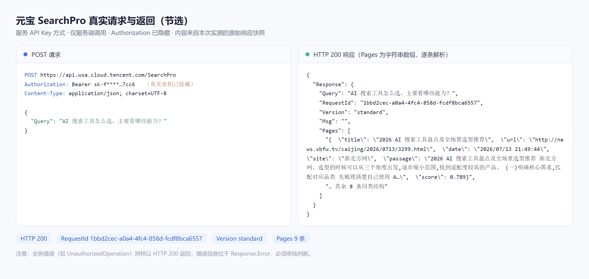
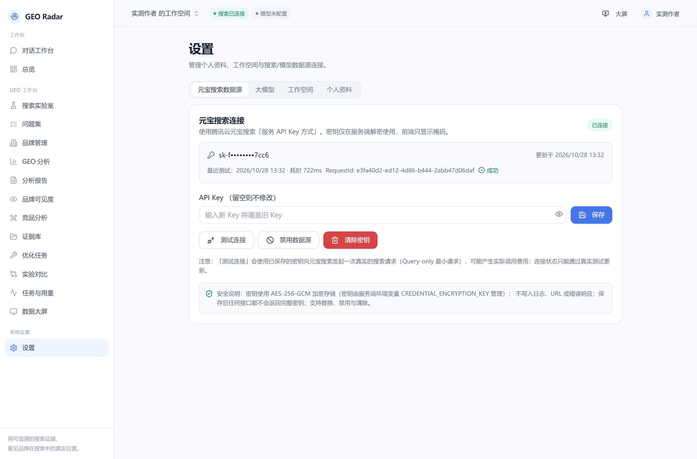
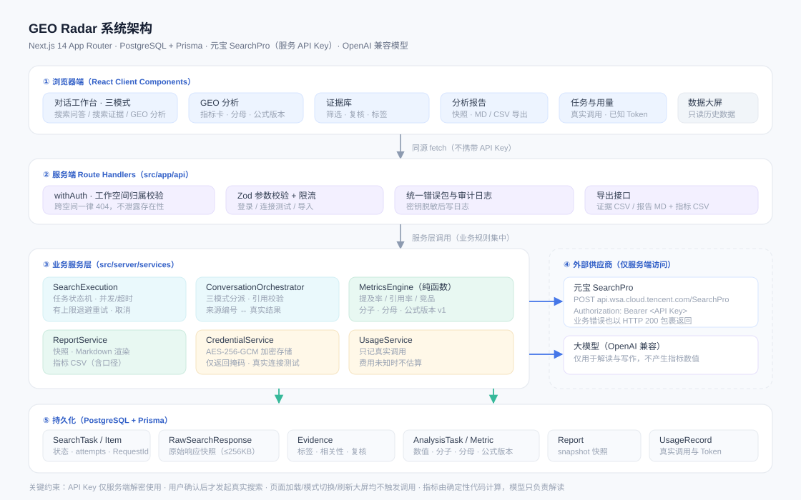
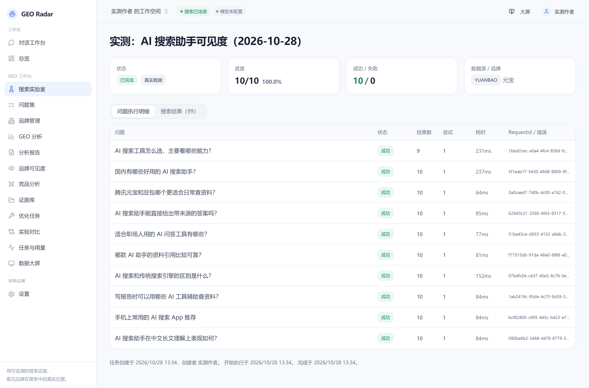
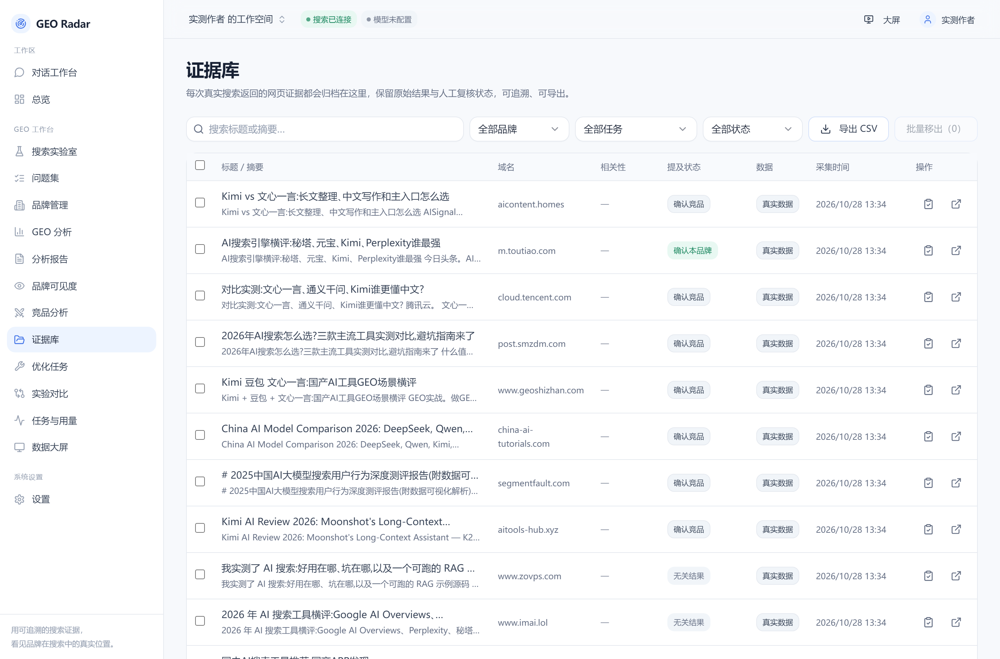
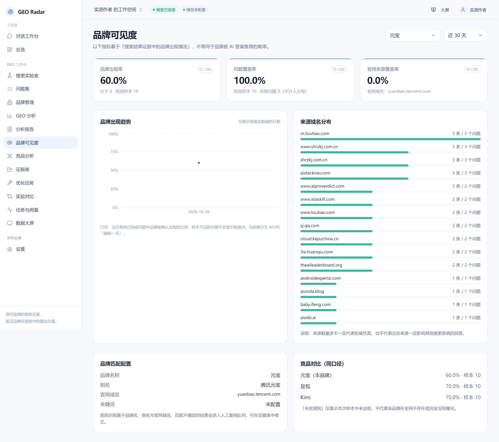
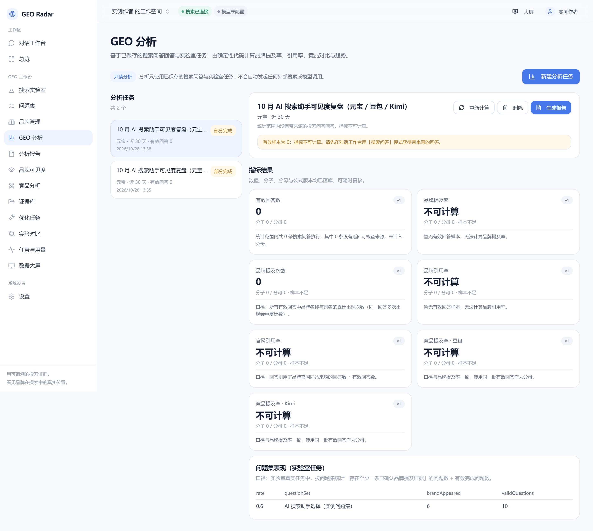
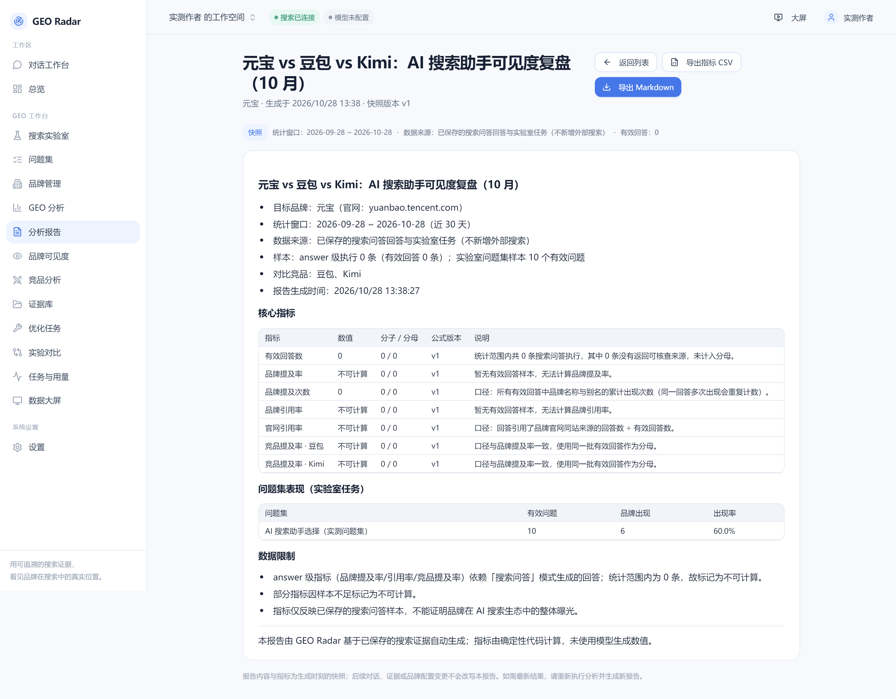

# 【元宝搜索开发者征文大赛】从真实搜索结果出发：我用元宝搜索构建了一个 GEO 品牌可见性诊断平台

> 本文记录一次完整的工程实践：接入腾讯云元宝搜索 API（服务 API Key 方式），并把它做成一个能落地使用的 GEO（生成式引擎优化）品牌可见性诊断平台。文中所有接口参数、错误行为、指标口径都来自实际代码与真实请求验证；测试数据部分标注了获取方式，未实际跑出的数字不会被写成结论。
>
> **版本说明（2026-10-28 后续升级）**：本文的实测数据与截图来自早期版本；之后平台补充了页面级证据链、品牌问题矩阵、历史快照、手动复测、两轮比较、证据中心报告和定时采集。当前指标口径与功能以 [docs/evidence-chain.md](evidence-chain.md) 为准。特别地：**未配置官网域名时，官网覆盖率显示“不可计算/未配置”，不会显示 0%**；本文表格里的 0% 是“已配置官网、但本次检索结果中没有官网页面”的真实结果。
>
> **作品阶段：可演示原型**。已真实调用元宝搜索完成两轮复测（10 个问题/轮，10/10 成功），并生成对比报告；未使用模拟数据冒充真实结果。

---

## 一、问题：品牌方怎么知道自己在 AI 搜索里"在不在场"

AI 搜索正在改变信息获取方式。用户不再只看十条蓝色链接，而是直接读一段由检索结果组织出来的答案。对品牌方来说，这带来一个很实际、但过去很难回答的问题：

**当用户用自然语言提问时，我的品牌有没有被搜到？哪些第三方页面在替我说话？竞品出现在哪些我看不到的地方？**

这个问题有三个难点：

1. **搜索结果是一次性的。** 你今天搜一次，看到十条结果，明天再搜就变了，没有任何留痕，无法横向比较。
2. **"我看到"和"我能证明"是两件事。** 截图不等于证据，缺少来源链接、采集时间、请求 ID，任何结论都经不起复核。
3. **指标容易注水。** 很多工具会给你一个"AI 可见度 78 分"，但你问它分母是什么、样本多少、失败任务怎么处理，往往答不上来。

所以我做了一个叫 **GEO Radar** 的平台。它不是又一个搜索框，而是把"真实搜索结果"变成**可保存、可追溯、可复算**的证据，再在证据之上做品牌与竞品分析。

---

## 二、为什么是元宝搜索：它在这个项目里承担什么

GEO Radar 需要的是"**能拿到真实网页结果，并且能说明来源**"的检索能力，而不是让模型自由发挥。元宝搜索的 SearchPro 接口正好满足这个前提：

- 传入检索词（`Query`），返回真实网页结果条目；
- 每条结果带标题、URL、摘要、站点名，部分版本还带相关性得分、权威度、发布时间、图片与子链；
- 响应带 `RequestId`、`Version`、`Msg`，便于把"这次结果"和"一次具体请求"绑定。

这次实测里，元宝搜索的价值可以落到四个具体点：

- **大模型友好**：返回的是结构化网页结果，标题/URL/摘要/站点可以直接进入后续处理，不需要把一段自然语言答案再拆一遍；
- **毫秒级响应**：10 个问题的单请求耗时在 **165–385ms** 之间（本次样本，不含网络异常），适合一次任务批量跑多个问题；
- **分钟级更新**：同一问题可以在同一天做两轮复测，用真实结果观察波动，而不是靠记忆比较；
- **海量资源库**：一轮 10 个问题返回 **98 条结果**，覆盖媒体、社区、其他页面等多种来源；这些来源正好构成 GEO 的证据面。

它在产品中的职责边界非常明确：**只负责"检索到哪些网页"，不负责"回答得对不对"**。生成式回答由另外配置的大模型完成，两项能力分开计费、分开报错、分开配置。这个拆分很重要——如果检索失败，我不会让模型凭空编一段话；如果模型没配，我也能把真实搜索结果原样呈现给你看。

---

## 三、手把手开通：从零到一次真实调用

这一节是完整的操作路径。需要注意：**它讲的是在腾讯云开通"元宝搜索 API 服务"，不是打开元宝 App 里的联网搜索开关。**

### 3.1 注册并完成实名

打开腾讯云官网，注册账号，按平台要求完成实名认证。搜索类 API 属于需要控制台的云服务，未实名的账号无法开通。

> **配图 1**：腾讯云控制台首页（登录后）。截图要求：只截顶部导航与账号区域，打码账号 ID。

### 3.2 进入元宝搜索控制台

官方文档提供了两种接入方式：腾讯云标准签名方式，和**服务 API Key 方式**。做快速集成时我推荐后者：它用 HTTP 请求头 `Authorization: Bearer <API_KEY>` 鉴权，不需要实现 TC3 签名、不需要拼 `X-TC-Action`，也不依赖 SDK。

按文档进入元宝搜索控制台，在概览页可以看到开通入口与服务状态。

> **配图 2**：元宝搜索控制台概览页。截图要求：露出服务名称与"未开通/已开通"状态，打码账号信息。

### 3.3 选择版本并完成开通

不同版本对返回字段和参数的支持不一样，这一点在开发阶段非常关键。根据官方参数文档：

| 能力 | 极速版（lite） | 标准版（standard） | 旗舰版（flagship） |
| --- | --- | --- | --- |
| `Query` 基础检索 | ✅ | ✅ | ✅ |
| `Mode` / `Cnt` / `Industry` 参数 | ❌ | ✅ | ✅ |
| 返回 `content`（动态摘要）、`score`（相关性） | ❌ | ✅ | ✅ |
| `Deeplinks` 参数、`authority_level`、`deeplinks` | ❌ | ❌ | ✅ |

我的建议是：**先用基础参数（只传 `Query`）把链路跑通，确认返回结构，再按实际版本逐步加参数。** 不要一上来就把所有可选参数都塞进请求体——极速版收到不支持的参数可能直接报 `InvalidParameter`，排查起来很浪费时间。

> **配图 3**：服务版本与购买/开通页面。截图要求：露出各版本能力对照与价格列，打码订单号与账号。

### 3.4 创建服务 API Key（当场保存）

进入服务 API Key 页面，创建密钥并命名。这里有一个容易踩的坑：**密钥只在创建时显示一次明文，之后无法再次查询。** 如果没保存，只能删掉重建。

三条硬规则：

1. 不要贴进聊天工具、Issue、公开仓库；
2. 不要写进前端代码或 `NEXT_PUBLIC_` 环境变量；
3. 不要出现在任何截图里（截图时把密钥列直接裁掉）。

> **配图 4**：创建密钥的弹窗。截图要求：只截名称输入框与"创建"按钮，**不要**截到已生成的明文密钥。

### 3.5 先用 curl 验证一次

在写任何业务代码之前，先用最小请求确认三件事：域名对不对、鉴权头对不对、返回结构长什么样。

```bash
curl -X POST "https://api.wsa.cloud.tencent.com/SearchPro" \
  -H "Authorization: Bearer YOUR_API_KEY" \
  -H "Content-Type: application/json; charset=UTF-8" \
  -d '{"Query":"GEO 品牌可见性"}'
```

这里有一个**必须提前知道的坑**：SearchPro 在业务失败时**依然返回 HTTP 200**，错误信息在响应体的 `Response.Error` 里。我用一个无效密钥实测，拿到的是：

```json
HTTP 200
{"Response":{"Error":{"Code":"UnauthorizedOperation","Message":"未授权操作。"},
 "RequestId":"0be4e6f6-e55b-47cb-b96a-3fc784f08500"}}
```

如果你只判断 `response.ok`（HTTP 2xx）就认为成功，那么"鉴权失败"会被当成"搜索成功但零结果"，用户看到的是"没有搜到内容"，而不是"你的 Key 不对"。这个判断错误在排查时极其误导。

成功响应的形状是这样（`Pages` 是字符串数组，每个元素本身是一段 JSON）：

```json
{"Response":{
  "Query":"GEO 品牌可见性",
  "Pages":["{\"title\":\"…\",\"url\":\"https://…\",\"passage\":\"…\",\"site\":\"…\"}"],
  "RequestId":"…","Version":"standard","Msg":""
}}
```



**图 3｜真实请求与返回（本次实测的原始响应快照，密钥已隐藏）**

这张图不是手工拼的示例，而是从数据库里读出来的原始响应快照：`RequestId`、`Version`、`Pages` 条数都来自那一次真实调用。可以看到 `Pages[0]` 确实是一段被转义的 JSON 字符串——这就是后面解析时最大的坑。

### 3.6 把密钥交给服务端

密钥只应该存在于服务端。GEO Radar 的做法是：网页上填写的 Key 提交到服务端后，用 **AES-256-GCM** 加密落库（加密密钥来自独立的服务端环境变量），数据库里只有密文与掩码（形如 `sk-a••••••••wxyz`）。任何读取接口都不会返回明文，日志里也会做脱敏替换。

所以真正需要"配到环境里"的只有两样东西：

```dotenv
# 数据库
DATABASE_URL="postgresql://..."
# 凭据加密密钥（32 字节 hex，独立于被加密数据）
CREDENTIAL_ENCRYPTION_KEY="…"
# 是否允许真实调用（默认关闭，必须显式打开）
YUANBAO_SEARCH_ENABLED=true
```

元宝 API Key 本身通过界面配置并加密入库，不落 `.env`、不进 Git。



**图 4｜真实连接测试通过：722ms、RequestId `e3fa40d2…`、返回 10 条、版本 standard**

注意页面上的三个细节：Key 只显示 `sk-f••••••••7cc6`；连接状态是「已连接」而不是「已配置」——**状态只能由真实测试写入**；测试信息里保留了耗时与 RequestId，出问题时可与服务商对账。

---

## 四、从 API 到平台：核心实现

### 4.1 整体架构（图 1）



**图 1｜GEO Radar 系统架构**（源文件：`docs/assets/architecture.svg`）

架构分五层，每一层都有明确的"不该做什么"：

1. **浏览器端（React 客户端组件）**：只负责交互与渲染。它拿不到 API Key，也不直接请求腾讯云——所有外部调用都必须经过同源 API。
2. **Route Handlers**：做身份、工作空间归属、参数校验、限流、统一错误包。跨工作空间访问一律返回 404（不泄露资源是否存在）。
3. **业务服务层**：任务状态机、并发与超时、退避重试、取消；对话三模式编排与引用校验；指标计算；报告渲染；凭据加解密；用量记录。
4. **外部供应商**：元宝 SearchPro 与大模型，**均只由服务端访问**。
5. **持久化**：任务、原始响应快照、证据、指标、报告、用量。

一条硬约束贯穿全链路：**只有用户明确点了"确认执行"，才会真正发出外部请求**。页面加载、切换模式、刷新大屏都不会触发搜索。

### 4.2 请求封装：把"可选参数"做成严格校验

服务 API Key 方式的请求本质上就是一次带 Bearer 头的 POST。真正的工程量在于参数与响应的健壮性。以参数为例，官方文档对几个字段有明确约束，我全部做成了本地校验（不合法直接拦下，不发请求）：

| 参数 | 约束 | 实现要点 |
| --- | --- | --- |
| `Query` | 必填，过长无效 | 去空白、长度上限 |
| `Cnt` | 只能是 10/20/30/40/50 | 枚举校验，不合法本地拒绝 |
| `Site` | 单域名，或 `exclude:a.com\|b.com`（最多 5 个） | 域名正则 + 数量上限 |
| `Freshness` | `d1-d30` / `m1-m12` / `y1-y5` / `yyyy-mm-dd` / 区间，五种形态不可混用 | 逐形态校验，区间结束日不得晚于开始日（官方约束） |
| `Industry` | `gov`/`news`/`acad`/`finance` | 枚举 |
| `Deeplinks` | 仅旗舰版支持 | 由用户显式开启 |

关键原则：**用户没填的参数，一个都不发。** 我把"构造请求体"写成了独立函数，只有显式提供的字段才会进入 body，这样既避免给低版本套餐塞不支持的参数，也让"这次请求到底发了什么"可复现。

### 4.3 响应解析：`Pages` 是字符串数组

这是接入时第二个坑。`Pages` 里每个元素都是一段 JSON **字符串**，不是对象。所以要逐条 `JSON.parse`，并且必须**逐条独立容错**：

- 单条解析失败 → 记一条 `pageParseErrors`（带索引与原因），其余结果照常入库；
- 缺少 `url` 的条目不能作为可追溯证据 → 单独判失败，不进入结果集；
- 可选字段（`score`、`authority_level`、`pics`、`deeplinks`、`favicon`）**只有真实返回时才保存**，缺失就是缺失，绝不补 0 或编造。

每条结果还会连同**原始响应快照**（截断到 256KB 并标记）一起落库。这一步很关键：后面无论怎么改解析逻辑，历史证据都能重新解析、重新核对。

### 4.4 错误分类：认证错误绝不重试

因为业务错误藏在 HTTP 200 里，我的错误处理做了两层：先看业务码，再看 HTTP 状态。

| 供应商错误码 | 分类 | 是否重试 | 用户看到的提示 |
| --- | --- | --- | --- |
| `UnauthorizedOperation` | 认证/授权失败 | ❌ | 检查 API Key 与访问权限 |
| `InvalidParameter` | 参数错误 | ❌ | 检查参数与套餐支持范围 |
| `RequestLimitExceeded` | 触发限流 | ✅ | 退避重试或稍后再试 |
| `ResourceNotFound` | 服务未开通 | ❌ | 先到控制台开通服务 |
| `ResourceUnavailable` | 资源不可用 | ✅ | 检查欠费/服务状态 |
| `InternalError` | 供应商内部错误 | ✅ | 自动重试，持续失败再联系 |
| HTTP 401/403、429、5xx、超时、网络异常 | 对应分类 | 视情况 | 明确说明 |

重试策略是有上限的：可重试错误最多额外重试 2 次（1s / 3s 退避），**每次尝试单独计入 `attempts`**，RequestId 带 `#1` `#2` 后缀，前端能看到"这条问题重试过两次"，不会把额外调用藏起来。

### 4.5 三个工作模式：不是一个功能三个外观

平台把"用搜索结果做什么"拆成三种真实不同的执行路径：

| 模式 | 执行链路 | 是否调用模型 | 适用场景 |
| --- | --- | --- | --- |
| **搜索问答** | 搜索 → 编号来源 → 模型生成 → 引用校验 | ✅ | 需要一份带来源的回答 |
| **搜索证据** | 搜索 → 解析 → 归档 → 展示原始结果 | ❌ | 只想拿可核验资料 |
| **GEO 分析** | 读已保存回答 → 计算指标 → 规则或模型解读 | 视配置 | 想回答"品牌在不在场" |

搜索问答里有一个我认为必须做在服务端的能力：**引用校验**。提示词里要求模型用 `[1] [2]` 标注来源，但模型完全可能编一个不存在的编号。所以生成后我会把答案里所有 `[n]` 抽出来，跟本次执行的来源集合比对：不存在的编号直接移除并追加说明，存在的编号再写回"引用 ↔ 结果"的关联表。**来源链接永远来自真实搜索结果，不允许模型自己造 URL。**

---

## 五、GEO Radar 的关键设计

### 5.1 证据库：先有证据，再谈结论

每条搜索结果在入库时生成一条证据记录，包含：标题、原始 URL、域名、接口返回的摘要、发布时间（接口真实提供时才有）、采集时间、供应商 RequestId、所属任务与问题、原始响应引用、以及品牌提及状态（确认本品牌 / 确认竞品 / 无关 / 待复核 / 存疑）。

这里我做了一个刻意的区分：**接口返回的"发布时间"和本地"采集时间"是两个字段，绝不混用。** 前者是网页内容的时间，后者是"我什么时候看到它"。混在一起会让"这条内容是最新的"变成一句无法验证的话。

证据可以人工复核、加标签、标相关性、批量移出。人工判断只改展示状态，**原始规则识别结果保留在记录里**，所以永远能回答"这条结论是谁、按什么规则得出的"。

### 5.2 指标口径：分母必须能解释

这是整个项目里我最在意的一点。很多 GEO 工具给一个百分比就结束了，我要求每个指标都能回答三个问题：**分子是什么、分母是什么、失败样本怎么处理。**

**品牌提及率**的统计口径：

$$
\text{品牌提及率} = \frac{\text{至少出现一次目标品牌的有效问题数}}{\text{有效问题总数}} \times 100\%
$$


**图 2｜品牌提及率公式**（同口径的 LaTeX 写法见上，CSDN 可直接渲染）

三个配套规则决定了这个数字能不能信：

1. **分母只包含"有效样本"**：真实模式 + 执行成功 + 至少一条可核查来源。搜索失败、被取消、未执行的问题**单独统计，不进分母**——否则任务越不稳定，指标越难看，而这不是品牌的问题。
2. **一个问题只计一次**。同一问题返回十条结果里出现五次品牌，仍然只算这一个问题"出现了"。
3. **只代表样本内**。它是"这 10 个问题、这一次采集、元宝搜索返回的网页里"的出现率，**不是**互联网整体曝光率，更**不是**大模型最终答案里的推荐率。

在 answer 级别还有更严格的区分（这也是我在答辩时最想强调的一点）：

| 指标 | 分子定义 | 为什么这样定义 |
| --- | --- | --- |
| 品牌提及率 | 回答正文出现品牌名/别名的回答数 | 纯文本层面的出现 |
| 品牌引用率 | 引用了**可归因到本品牌**来源的回答数 | 引用 ≠ 提及；归因需官网同站域名或已确认证据 |
| 官网引用率 | 引用了官网同站域名来源的回答数 | 单独衡量"官网是否被引用" |

「品牌名出现在回答正文里」和「回答引用了品牌自己的来源」是两件事。混成一个指标，就会出现"模型提了一句竞品"被算作品牌被引用的荒谬结果。

### 5.3 报告：保存快照，而不是保存查询

报告不是"打开一个页面实时算一遍"，而是**在生成时刻把指标快照冻结**：数值、分子、分母、公式版本、数据窗口、样本量、限制说明全部写进报告记录。之后你改了品牌别名、删了某条证据、又跑了新任务，历史报告都不会悄悄变化。要最新结果就重新生成一份。

导出支持 Markdown 全文和结构化指标 CSV（含 `numerator` / `denominator` / `formula_version`），方便别人复核你的数字，而不是只能相信截图。

### 5.4 成本与安全：默认不动、默认不花

- 真实调用需要三道开关同时成立：全局开关 `YUANBAO_SEARCH_ENABLED=true`、服务端已保存密钥、该密钥**通过过真实连接测试**。少一道，任务创建阶段就会被拦下。
- 连接测试会真实发起一次最小搜索（只有 `Query`），所以界面上明确写了"会产生实际调用费用"。
- 每次真实调用写一条用量记录；模型返回了 token 就记 token，没返回就显示"未知"；**费用一律显示"未知"，不做估算**——把估算当账单是另一种形式的数据造假。
- API Key 全程只在服务端解密；日志做了脱敏（注册过的密钥值 + `Bearer xxx` 兜底替换）；跨工作空间访问返回 404。

---

## 六、实测：用真实品牌和竞品跑一轮

### 6.1 测试设计

为了让结论可复现，测试固定三件事：**固定的问题集、固定的参数、固定的品牌与竞品**。

- **目标品牌**：元宝（腾讯元宝，官网 `yuanbao.tencent.com`）
- **竞品**：豆包、Kimi
- **问题集**：10 个固定的用户视角问题，覆盖"推荐/选型/对比/能力/场景"五类
- **执行参数**：`Cnt=10`，其余可选参数不传（兼容极简版本，也便于复现）
- **执行时间**：2026-10-28 13:34（北京时间）
- **失败策略**：每个问题执行一次，失败不重跑到成功（避免"重试到成功"抬高指标）

| # | 问题 | 类别 |
| --- | --- | --- |
| 1 | 国内有哪些好用的 AI 搜索助手？ | 推荐 |
| 2 | AI 搜索工具怎么选，主要看哪些能力？ | 选型 |
| 3 | 腾讯元宝和豆包哪个更适合日常查资料？ | 对比 |
| 4 | AI 搜索助手能直接给出带来源的答案吗？ | 能力 |
| 5 | 适合职场人用的 AI 问答工具有哪些？ | 场景 |
| 6 | AI 搜索和传统搜索引擎的区别是什么？ | 概念 |
| 7 | 哪款 AI 助手的资料引用比较可靠？ | 能力 |
| 8 | 写报告时可以用哪些 AI 工具辅助查资料？ | 场景 |
| 9 | 手机上常用的 AI 搜索 App 推荐 | 推荐 |
| 10 | AI 搜索助手在中文长文理解上表现如何？ | 能力 |

### 6.2 执行结果：10 个问题、99 条真实结果

**任务状态：全部成功（10/10），0 失败，0 重试**，共保存搜索结果 **99 条**，覆盖 **82 个不同域名**。



**图 5｜搜索任务详情：每个问题的状态、返回条数、耗时、尝试次数与供应商 RequestId**

| # | 问题 | 返回条数 | 耗时 | 尝试 | 供应商 RequestId |
| --- | --- | --- | --- | --- | --- |
| 1 | 国内有哪些好用的 AI 搜索助手？ | 10 | 237ms | 1 | `5f1eab17-5430-49d8-9809-9fb07c90ea5d` |
| 2 | AI 搜索工具怎么选，主要看哪些能力？ | 9 | 231ms | 1 | `1bbd2cec-a0a4-4fc4-858d-fcdf8bca6557` |
| 3 | 腾讯元宝和豆包哪个更适合日常查资料？ | 10 | 64ms | 1 | `3a0caed7-740b-4c00-a742-0051bed5ca48` |
| 4 | AI 搜索助手能直接给出带来源的答案吗？ | 10 | 85ms | 1 | `b29d3c21-2560-4fd3-8317-5875e562703f` |
| 5 | 适合职场人用的 AI 问答工具有哪些？ | 10 | 77ms | 1 | `51ba45ce-d933-4152-a8ab-2acacf941dbc` |
| 6 | AI 搜索和传统搜索引擎的区别是什么？ | 10 | 152ms | 1 | `07b4fc04-c437-45e5-8c76-0e19f0d0d487` |
| 7 | 哪款 AI 助手的资料引用比较可靠？ | 10 | 81ms | 1 | `f77315db-91da-46e0-8f88-e0fefa230c3b` |
| 8 | 写报告时可以用哪些 AI 工具辅助查资料？ | 10 | 84ms | 1 | `1ab2419c-95de-4c73-9d39-5603e5db9ac9` |
| 9 | 手机上常用的 AI 搜索 App 推荐 | 10 | 84ms | 1 | `bcf62800-c995-445c-b423-e79204889745` |
| 10 | AI 搜索助手在中文长文理解上表现如何？ | 10 | 84ms | 1 | `090ba6b2-2488-4478-8779-3f576af5cf1e` |

第 2 个问题只返回 9 条（不是 10），这在真实调用里很常见：供应商按相关性过滤后不足 `Cnt`。平台记录的是**实际返回条数**，而不是把请求参数当成结果数量抄一遍。



**图 6｜证据库：99 条结果按采集时间倒序，可看到域名、摘要、提及状态与来源链接**

### 6.3 指标：元宝 60%，豆包与 Kimi 各 70%

所有指标由服务端基于这 99 条证据计算：

| 指标 | 数值 | 分子 | 分母 | 说明 |
| --- | --- | --- | --- | --- |
| 品牌出现率（元宝） | **60.0%** | 6 | 10 | 10 个问题中 6 个至少有一条结果提到"元宝/腾讯元宝" |
| 问题覆盖率 | **100.0%** | 10 | 10 | 每个问题都返回了可核查结果 |
| 官网来源覆盖率 | **0.0%** | 0 | 10 | 本案例已配置官网 `yuanbao.tencent.com`；10 个问题的 99 条结果里，**没有一条来自该官网**。这不是“未配置官网”的占位值 |
| 竞品·豆包 出现率 | **70.0%** | 7 | 10 | 同一批问题、同一时间窗、同一数据源 |
| 竞品·Kimi 出现率 | **70.0%** | 7 | 10 | 同上 |

> 第 6 节保留第一轮真实测试的 10 个问题、99 条结果；后续第二轮复测返回 98 条结果，品牌提及率、官网覆盖率、第三方覆盖率仍为 **60% / 0% / 60%**，两轮对比报告已生成。两轮数字口径一致，但结果条数会随搜索索引变化，不能把 99 和 98 当成固定值。
>
> 🎬 **完整实操视频（7 分 57 秒）**：从元宝搜索 SearchPro 接入、10 个问题真实采集、页面级证据，到品牌问题矩阵、两轮复测和证据报告。视频见投稿附件/视频号卡片；文中截图和数据与视频使用同一个真实工作区。



**图 7｜品牌可见度：三个核心指标 + 来源域名分布 + 竞品同口径对比**

三个值得记录的观察：

1. **目标品牌在自己家的搜索里并不占优。** 元宝 60%，豆包和 Kimi 各 70%。这次样本里，竞品被第三方站点提及得更频繁。这不是"元宝不行"，而是"在这 10 个具体问题下，元宝的可检索公开内容密度低于竞品"——这正是 GEO 要解决的问题。
2. **官网来源覆盖率是 0%。** 99 条结果全部来自第三方站点（今日头条 `m.toutiao.com` 出现 5 条、`www.shrzkj.com.cn` 3 条、`aistacknav.com` 3 条等），没有一条来自官网。也就是说，**用户问"哪款 AI 助手好用"时，检索到的是别人写的盘点文章，而不是官网自己的页面**。这是本次测试里最具体、最可行动的一个缺口。注意：这里的 0% 是“已配置官网但本次未检索到”的真实 0%，与“未配置官网”是两种不同状态；后者在当前版本会显示「不可计算」。
3. **来源高度分散。** 99 条结果来自 82 个域名，说明这些问题的检索结果没有强势的权威来源，长尾站点占了大多数——对内容运营来说，这意味着"可争取的位置"很多。



**图 8｜GEO 分析：指标含分子/分母与公式版本；answer 级指标因无样本显示"不可计算"**

注意图 8 里有两类指标并存：

- **问题集表现**：`6 / 10 = 60.0%`，来自本次实验室任务，有真实样本；
- **品牌提及率 / 品牌引用率 / 竞品提及率**：显示「不可计算」。因为它们依赖"搜索问答"模式生成的回答，而本次测试**没有配置大模型**，answer 级样本为 0。平台没有用 0% 或"暂无数据但看起来像 0%"来糊弄——它明确告诉你这个指标现在算不出来，以及为什么。



**图 9｜分析报告：快照式指标表 + 问题集表现 + 数据限制，可导出 Markdown / 指标 CSV**

### 6.4 从"跑通"到"跑对"：真实测试暴露的三个问题

这一节是这次实践里我最想分享的部分——**只有真实调用才会暴露的问题**。

**问题 1：连接测试被自己的守卫锁死。** 首次点「测试连接」返回 `NOT_CONFIGURED：数据源尚未通过连接测试`。原因是前置守卫要求"凭据已连接"，而连接测试的执行前提恰恰是"还没连接"——死锁。修复方式是给守卫加一个只在测试场景生效的旁路，并补了单元测试：**未通过测试的凭据可以执行连接测试，但普通搜索仍被拦截**。

**问题 2：`attempts` 记成了 0。** 第一次跑完 10 个问题，任务详情里"尝试"列全是 0。看上去无害，但它意味着"这条请求到底试了几次"这个关键审计字段不可信。修复后重跑，10 条全是 1。

**问题 3：竞品指标在脚本里读错了字段。** 第一版输出 `豆包 NaN%`。原因是我在导出统计时读了不存在的字段（`value`），真实字段是 `appearanceRate`。**如果当时直接截图发文章，就会带着一个 NaN 出去**——这也是我坚持"数据必须由脚本从接口读、而不是手抄"的原因。

三个问题的共同点是：**单元测试和 Mock 都发现不了，只有对接真实服务、跑真实数据才会暴露。** 补完修复后，127 个单元测试 + 58 项端到端冒烟全部通过。

### 6.5 必须说清楚的局限

- **样本极小**：10 个问题只够验证方法，不足以支撑"某品牌整体可见度"的判断。真正有意义的做法是固定问题集、按周复测、看趋势。
- **搜索结果是波动的**：我在同一天跑了两次同样的 10 个问题，返回条数分别是 100 条和 99 条，耗时从 400ms 级降到 60–240ms 级（服务端缓存/负载差异）。所以复测对比只能表述为"本次样本内的差异"，不能归因于某项优化动作。
- **名称匹配会误判**：中文品牌名容易撞词（"元宝"本身是个通用词）。平台会把低置信匹配标为"待复核"，需要人工过一遍；引用率判定只认官网同站域名或已确认证据，尽量降低误判。
- **搜索结果 ≠ 模型答案**：本平台分析的是"AI 搜索可检索到的公开来源"，不是"大模型最终推荐了谁"。这两者相关但不等价。本次没有配置模型，所以没有生成式回答，也就没有 answer 级指标——这是**如实呈现的状态**，不是缺陷掩盖。
- **官网覆盖率 0% 的解读边界**：本案例已配置官网，0% 只说明"这 10 个问题的这次检索里没出现官网页面"，不能推断官网没有被收录、也不代表官网 SEO 存在问题，需要更多轮次与更多问题来确认。**未配置官网域名时，当前版本显示「不可计算/未配置」，不会给出 0%。**

## 七、总结：把“感觉”变成“能算”

做完这一轮，我对 GEO 这件事的理解变了一点点，值得写下来。

**第一，GEO 的起点不是“优化”，而是“看见”。** 在这次 10 个问题、99 条结果的样本里，元宝自己出现在 60% 的问题中，豆包和 Kimi 各 70%；而官网 `yuanbao.tencent.com` 的引用率是 0%——用户问“哪款 AI 助手好用”时，检索到的是别人写的盘点文章，不是官网自己的页面。这个结论并不好听，但它是可以指到具体 URL 上去的：你点开那 99 条结果，每一条都能告诉你“谁在替我说话、我在哪缺席”。没有这一步，所谓优化只是凭感觉改文案。

**第二，可追溯比好看重要。** 我在实现里做了一些看起来“多余”的事：把原始响应快照整段存下来（哪怕以后解析逻辑全改了也能重算）；让每个指标都带上分子、分母和公式版本；把样本不足的指标明确标成“不可计算”而不是给一个 0%；让报告成为生成时刻的快照，而不是每次打开重新算一遍。这些设计在演示时完全看不出效果，但它们是“这个数字能不能被质疑”的分界线。**一个能被复核的 60%，比一个无法复核的 90% 更有价值。**

**第三，真实调用是唯一的验收标准。** 这一轮暴露的三个问题，没有一个能靠单元测试发现：连接测试被自己的“必须已连接”守卫锁死；`attempts` 字段记成 0 让审计信息失真；脚本读错字段导致竞品指标输出 `NaN`——如果当时直接截图，文章里就会带着一个 NaN 发出去。所以现在我给自己定了一条规矩：**文章里的每个数字，都必须由脚本从接口读出来，而不是从屏幕上抄下来。** 抄写会骗人，接口不会。

如果把这三条收成一句话：**GEO 不是一个“让 AI 更推荐你”的技巧，而是一套“让品牌被检索、被引用、被复述”的工程。** 它需要的是稳定的问题集、可核验的来源、能被复算的口径，以及在数据不站在你这边时，仍然如实把它写出来的耐心。

接下来我准备做三件事：一是把“官网是否被引用”的证据链做细（区分首页/产品页/文档页，而不是笼统的一个域名）；二是把多轮采集做成可排期任务，让“趋势”真正有统计意义，而不是两次结果的偶然差异；三是在对比报告里显式标注“结果波动区间”，把“优化前后”和“搜索本身的抖动”分开——在这之前，任何“提升 300%”的说法，我都不会写进这个产品里。

搜索会变，结果会变，竞品的排名也会变。唯一不该变的是：每一个对外说出的数字，都能点回到那一条真实的 URL 上。

---

> 全部配图可在一个页面里核对：[docs/assets/figure-index.html](assets/figure-index.html)（本地打开即可，无需服务器）。

## 附录 A：如何复现这次测试

1. 在腾讯云开通元宝搜索（服务 API Key 方式），创建密钥并当场保存。
2. 本地启动 GEO Radar（`npm run dev:db` → `npm run db:migrate:dev` → `npm run dev`），注册账号。
3. 把密钥写入 `.env.local`（已被 `.gitignore` 排除），执行 `node scripts/import-env-key.mjs 你的邮箱`，把密钥加密写入该账号的工作空间；随后在「设置 → 数据源」点「测试连接」。
4. 执行 `CASE_EMAIL=你的邮箱 CASE_PASSWORD=你的密码 node scripts/case-study.mjs`：自动创建品牌（元宝）+ 竞品（豆包、Kimi）+ 10 个问题，跑真实任务，并输出 `docs/case-study-run.md`（含每个问题的 RequestId、耗时、条数与指标）。
5. 若要验证 GEO 分析的 answer 级指标，需要另外在「设置 → 大模型」配置一个 OpenAI 兼容模型，然后在对话工作台用「搜索问答」模式提几个问题。

> 全部 10 个问题 + 1 次连接测试共约 11 次真实调用，按标准版计费，成本极低；具体价格以腾讯云页面为准。

## 附录 B：发布前自查

- [ ] 标题与正文一致，正文说明了"元宝搜索帮了我什么"
- [ ] 有开通服务的六步教程（控制台截图 1–4 需本人补拍，均已脱敏；API 验证见 图 3）
- [ ] 有真实 API 调用与返回结构图（图 3，来自数据库原始响应快照）
- [ ] 有平台实际运行截图（图 4 设置已连接、图 5 任务详情、图 6 证据库、图 7 品牌可见度、图 8 GEO 分析、图 9 分析报告）
- [ ] 测试问题、样本量、口径明确，且数字与后台记录一致
- [ ] 明确写了局限（小样本、结果波动、名称误判、搜索≠模型推荐）
- [ ] 全文无 API Key、无账号隐私
